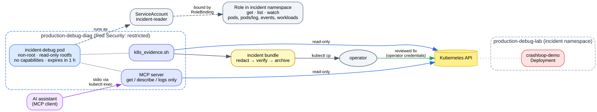
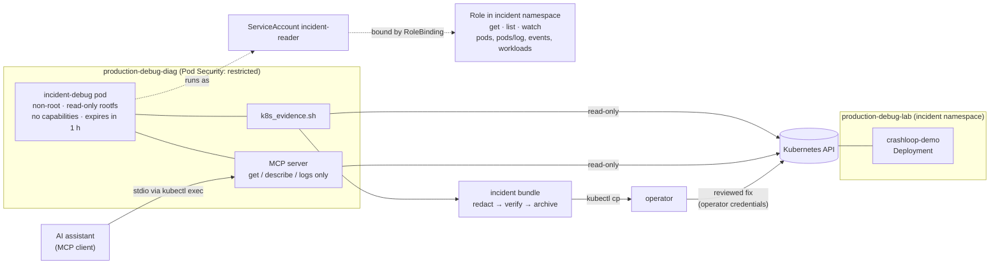

# production-debug

[](https://github.com/ManuJacks/production-debug/actions/workflows/ci.yml)
[](https://m8ven.ai/mcp/manujacks-production-debug-1mpz9n?s=readme)
[](LICENSE)

**How do you debug production without making production worse?**

`production-debug` is a Kubernetes incident-diagnostics toolkit built around one constraint: the people and tools investigating an incident should be *able* to read what they need, and *unable* to change anything. That includes AI assistants.

It provides an ephemeral, least-privilege diagnostic pod, a read-only evidence collector, a sanitized and verifiable incident bundle, and an MCP server that lets an AI assistant investigate under the same read-only identity. Remediation stays with a human operator using separate credentials.

---

## See it work

`demo/run.sh` reproduces a complete incident on a disposable cluster and checks every safety property as it goes. It stops at the first expectation that does not hold.

| Step | What happens | What it proves |
|---|---|---|
| 1. Break | Deploys a workload that crash-loops (`missing CONFIG_URL`) | A real, observable failure |
| 2. Isolate | Starts a diagnostic pod in its own namespace | Pod Security `restricted`, non-root, read-only root filesystem, no capabilities, self-expires after 1 h |
| 3. Prove | Runs 12 `kubectl auth can-i` checks and a live server-side-dry-run delete from inside the pod | Reads allowed in the incident namespace only; every write, `exec`, Secret, ConfigMap and cluster-scope request denied |
| 4. Collect | Gathers pods, events, descriptions and logs *as the diagnostic identity* | Structured evidence with a per-step `manifest.json`, redacted, verified and archived; the archive is re-verified locally, and an incident record (INC) is drafted from it at a derived severity |
| 5. Investigate | An MCP client (as an AI assistant would) queries the cluster through the MCP server running *inside the diagnostic pod* | The AI finds the root cause using only `get`/`describe`/`logs`; an out-of-scope request is Forbidden |
| 6. Remediate | The operator applies the reviewed fix with operator credentials | The diagnostic identity never performs the change |
| 7. Verify | Waits for rollout, then a 20 s stability window | All pods Ready with zero restarts |
| 8. Clean up | Removes both namespaces; no cluster-scoped objects were created | Safe to run again; cleanup is idempotent |

CI runs the whole sequence on a fresh kind cluster for every push and pull request (`e2e-incident-demo` job). It has also been run end to end on a five-node kubeadm cluster (three control planes, Cilium), including [while the etcd leader was powered off](https://github.com/ManuJacks/kubernetes-in-finance/blob/main/docs/gameday/2026-11-21-api-availability.md). On that cluster it surfaced a real fault: see the [field report](docs/field-reports/2026-11-21-clock-drift.md).

### Run it

Requirements: `kubectl`, Python 3.12, Docker (for a local image), and a **disposable** cluster where creating and deleting the `production-debug-lab` and `production-debug-diag` namespaces is acceptable.

```bash
python3 -m venv demo/.venv && demo/.venv/bin/pip install -r demo/requirements.txt

# kind example: build the image locally and load it into the cluster
docker build -f docker/Dockerfile -t production-debug:local .
kind load docker-image production-debug:local

DEMO_CONTEXT=kind-kind DEMO_IMAGE=production-debug:local demo/run.sh run
```

The script prints the target context and API server, then asks you to type `<context>/production-debug-lab` before changing anything. Remove everything at any time with `demo/run.sh cleanup`.

---

## Architecture



<details>
<summary>View Mermaid Source</summary>



</details>

Two independent controls stop the AI from changing the cluster:

1. **Tool design.** The MCP server exposes four Kubernetes tools. All of them run through one function that refuses any `kubectl` verb other than `get`, `describe` and `logs`, and every argument is validated against Kubernetes naming rules before it reaches `kubectl`.
2. **Identity.** The MCP server runs inside the diagnostic pod under a ServiceAccount that has no write permissions. Even a tool bug could not mutate anything.

---

## Security model

Every row below is enforced in code and covered by a test or a demo check. Anything not in this table should be treated as unverified.

| Property | Enforced by | Verified by |
|---|---|---|
| Diagnostic identity cannot write, `exec`, read Secrets/ConfigMaps or reach other namespaces | Namespace-scoped `Role` (`demo/manifests/diagnostics.yaml`) | Demo step 3 (12 `auth can-i` checks + live dry-run delete); `tests/test_demo_contract.py` |
| Diagnostic pod runs non-root, read-only, with no capabilities | Pod spec + `restricted` Pod Security admission | Admission rejects a non-compliant pod (demo step 2); `tests/test_demo_contract.py` |
| MCP tools can only run `get`/`describe`/`logs` | `_run_kubectl` allowlist in `mcp/server.py` | `tests/test_mcp_kubernetes.py` (19 mutating/interactive verbs refused) |
| MCP arguments cannot inject flags or shell syntax | Kubernetes name validation before execution | `tests/test_mcp_kubernetes.py` |
| MCP and evidence output is redacted and size-bounded | `production_debug/sanitizer.py` | `tests/test_mcp_and_security.py`, `tests/test_mcp_kubernetes.py` |
| Evidence collector never requests Secrets or ConfigMap data | Fixed command set in `scripts/k8s_evidence.sh` | `tests/test_k8s_evidence.py` |
| Evidence collection survives missing resources and API failures | Per-step status, bounded retries recorded in `manifest.json` | `tests/test_k8s_evidence.py` |
| A bundle that fails sanitization or verification is deleted, not shipped | Fail-closed `scripts/incident_bundle.sh` | `tests/test_support_scripts.py` (failure injection) |
| Bundle archives with path traversal, absolute paths, links or oversized payloads are rejected | `production_debug/bundle_verifier.py` | `tests/test_mcp_and_security.py`, `tests/test_demo_contract.py` |
| Incident records are drafted only from a verified bundle, contain only source-quoted facts (no inferred root cause), and derive severity from impact × urgency | `production_debug/incident_record.py` ([ADR 007](docs/adr/007-incident-records-from-verified-evidence.md)) | `tests/test_incident_record.py` |
| Scenario and demo scripts refuse to act without naming the exact target | Typed `<context>/<namespace>` confirmation | `tests/test_scenario_runner.py`, `tests/test_demo_contract.py` |

### Limitations

- **Redaction is pattern-based.** It catches recognized credential formats (JWTs, private keys, bearer tokens, common key/password assignments). Unrecognized secrets can remain. Review bundles before sharing them.
- **Logs are evidence and may contain sensitive data.** `pods/log` access is required to diagnose most incidents.
- **Bundles are verified, not tamper-proof.** The SHA-256 fingerprint detects accidental change; it is not a signature.
- **The demo's Role is namespace-scoped.** The general-purpose manifests in `k8s/` and `gitops/` use a cluster-wide read-only ClusterRole that also covers nodes and ConfigMaps; review it before use.
- **The privileged variant (`k8s/debug-pod-privileged.yaml`) is not part of the tested security model.** Its added capabilities are not effective for a non-root user without further configuration, and it has not been validated.
- **Only the four Kubernetes MCP tools are covered by the read-only guarantee.** `generate_incident_bundle` writes local files and is annotated `readOnlyHint=false`; the DNS, Azure identity and packet-capture tools are outside the demo.

### Supply chain

The publish workflow builds multi-architecture images for pushes to `main` and version tags, signs them keylessly with cosign (GitHub OIDC), and attaches a CycloneDX SBOM. Signature (`.sig`) and SBOM (`.sbom`) artifacts are visible next to each published digest in GHCR. To verify an image yourself:

```bash
cosign verify ghcr.io/manujacks/production-debug@<digest> \
  --certificate-identity-regexp 'https://github.com/ManuJacks/production-debug/.github/workflows/publish-container.yml@.*' \
  --certificate-oidc-issuer https://token.actions.githubusercontent.com
```

This command was run with cosign v3.1.4 against the `latest` digest on 2026-11-21 and verified the signature, the transparency-log entry and the certificate chain. Pre-release `-rc` images were pushed manually for testing and are **not** signed. Build-provenance attestation is not implemented.

---

## Toolkit components

```text
production-debug/
├── demo/                   # End-to-end incident demonstration
├── docker/                 # Diagnostic container image (non-root)
├── mcp/                    # MCP server (read-only Kubernetes tools + diagnostics)
├── production_debug/       # Sanitizer and bundle verifier
├── scripts/                # Evidence collection, bundling, preflight, KPI tooling
├── scenarios/              # Synthetic Kubernetes failure manifests
├── k8s/  gitops/           # General-purpose deployment manifests (Kustomize / Flux)
├── vm/  dev-lab/           # VM launchers and local practice environments
├── tests/                  # Automated tests
└── docs/                   # ADRs, procedures, exercises
```

### Diagnostic runtime

The container packages a collection of infrastructure troubleshooting tools, including:

| Tool | Operational purpose |
|---|---|
| kubectl | Kubernetes API inspection |
| K9s | Interactive Kubernetes resource navigation |
| Stern | Multi-pod and multi-container log streaming |
| kubectx / kubens | Context and namespace navigation |
| kubectl-neat | Cleaner Kubernetes resource output |
| kubectl-tree | Resource ownership visualization |
| tmux | Persistent multi-pane diagnostic workspace |
| tcpdump / iproute2 / conntrack | Network and connection inspection |
| dig / nslookup / curl | DNS, HTTP and connectivity investigation |
| Azure CLI | Azure resource and network diagnostics |

The image is built from Debian Bookworm Slim. Kubernetes tooling versions are explicitly declared in the Dockerfile, and the Helm archive is SHA-256 verified during installation.


---

## Troubleshooting examples

The following workflows illustrate how the toolkit supports evidence-driven investigation. They use standard Kubernetes commands and the repository's synthetic scenarios.

The examples are laboratory demonstrations, not claims of completed production incidents.

### 1. CrashLoopBackOff — application startup failure

A synthetic startup command reports a missing CONFIG_URL and exits with status 1, simulating an application startup failure.

Inspect the workload:

```bash
kubectl get pods -n production-debug-lab
kubectl describe pod -n production-debug-lab -l app=crashloop-demo
```

Inspect the previous container execution:

```bash
kubectl logs -n production-debug-lab \
  -l app=crashloop-demo --previous
```

**Evidence to look for:**

- Container restart count.
- Exit code and termination reason.
- Previous container logs.
- Pod events and restart timing.

**Engineering lesson:** Distinguish an application startup failure from an infrastructure or scheduling failure before changing the workload.

### 2. ImagePullBackOff — image retrieval failure

**Scenario:** The workload references a synthetic image that does not exist.

Inspect pod events:

```bash
kubectl describe pod -n production-debug-lab \
  -l app=imagepull-demo
```

Inspect the configured image:

```bash
kubectl get deployment imagepull-demo \
  -n production-debug-lab \
  -o jsonpath='{.spec.template.spec.containers[*].image}'
```

**Evidence to look for:**

- Requested image and tag.
- Registry hostname.
- Pull failure messages.
- Whether the failure indicates a missing manifest, registry access issue or authentication problem.

**Engineering lesson:** Separate image-reference errors from registry connectivity and authentication failures.

The current synthetic manifest demonstrates a nonexistent image reference. Invalid registry credentials are a useful additional exercise, but are not currently configured by this manifest.

### 3. Pending pod — scheduling constraints

**Scenario:** A pod cannot be scheduled because its node selector does not match available nodes and its CPU request is deliberately high.

Inspect scheduling events:

```bash
kubectl describe pod -n production-debug-lab \
  -l app=pending-demo
```

Inspect available nodes and allocatable resources:

```bash
kubectl get nodes
kubectl describe nodes
```

**Evidence to look for:**

- Node selector requirements.
- Scheduler failure events.
- Available node capacity.
- Resource requests versus allocatable resources.

**Engineering lesson:** A Pending pod is not necessarily an application problem. Investigate scheduling predicates and cluster capacity.

### 4. Readiness failure — traffic eligibility

**Scenario:** NGINX is running, but the readiness probe checks an invalid HTTP path.

Inspect pod conditions:

```bash
kubectl describe pod -n production-debug-lab \
  -l app=readiness-demo
```

Inspect Service and EndpointSlices:

```bash
kubectl get service,endpoints -n production-debug-lab
kubectl get endpointslices -n production-debug-lab
```

**Evidence to look for:**

- Container running state.
- Readiness probe failures.
- Pod readiness condition.
- Service endpoint membership.

**Engineering lesson:** Running does not mean ready. Readiness determines whether a workload is eligible to receive Service traffic.

### 5. DNS failure — name resolution

**Scenario:** A diagnostic pod attempts to resolve a deliberately nonexistent Service name.

Inspect the pod:

```bash
kubectl describe pod -n production-debug-lab dns-demo
```

Inspect its logs:

```bash
kubectl logs -n production-debug-lab dns-demo
```

Compare with a known Kubernetes Service:

```bash
kubectl exec -n production-debug-lab dns-demo -- \
  nslookup kubernetes.default.svc.cluster.local
```

**Evidence to look for:**

- DNS lookup response.
- Resolver configuration.
- Whether known Service names resolve.
- CoreDNS pod health and relevant events.

**Engineering lesson:** Separate an invalid application hostname from resolver, cluster DNS and upstream DNS failures.

### 6. NetworkPolicy denial — traffic restrictions

**Scenario:** A default-deny ingress and egress policy is applied to the synthetic namespace.

Inspect the policy:

```bash
kubectl get networkpolicy -n production-debug-lab
kubectl describe networkpolicy deny-all-demo \
  -n production-debug-lab
```

Inspect the affected workload:

```bash
kubectl get pods -n production-debug-lab -o wide
kubectl describe pod -n production-debug-lab \
  -l app=networkpolicy-demo
```

**Evidence to look for:**

- Policy selectors.
- Ingress and egress policy types.
- Affected pod labels.
- Connectivity differences when the policy is present.

**Engineering lesson:** NetworkPolicy troubleshooting requires understanding selectors, policy direction and the behavior of the cluster's network implementation. Enforcement depends on CNI support; a policy may exist in the Kubernetes API without actually blocking traffic if the network plugin does not enforce NetworkPolicy rules.

### 7. OOMKilled — memory pressure

**Scenario:** A synthetic workload attempts to allocate more memory than its container limit permits.

Inspect the pod:

```bash
kubectl describe pod -n production-debug-lab \
  -l app=oom-demo
```

Inspect container state and restart history:

```bash
kubectl get pods -n production-debug-lab
kubectl logs -n production-debug-lab \
  -l app=oom-demo --previous
```

**Evidence to look for:**

- Container termination reason.
- Memory limit and request.
- Restart count.
- Pod and node events.

**Engineering lesson:** Distinguish container-level OOM termination from node-pressure eviction and investigate resource sizing and QoS implications.

### 8. RBAC Forbidden — authorization boundaries

**Scenario:** A dedicated ServiceAccount can read pods but does not have permission to read pod logs or deployments.

**Prerequisite:** The user running these checks must have permission to impersonate the specified ServiceAccount.

Check authorization:

```bash
kubectl auth can-i get pods \
  --as=system:serviceaccount:production-debug-lab:restricted-demo \
  -n production-debug-lab

kubectl auth can-i get pods/log \
  --as=system:serviceaccount:production-debug-lab:restricted-demo \
  -n production-debug-lab

kubectl auth can-i get deployments.apps \
  --as=system:serviceaccount:production-debug-lab:restricted-demo \
  -n production-debug-lab
```

**Expected result:** Pod reads are allowed; pod log and deployment reads are denied by the synthetic Role.

**Engineering lesson:** Use authorization checks to identify the missing permission and grant only the access required by the diagnostic task.

---

## Synthetic Kubernetes failure lab

The repository contains eight synthetic manifests for practicing controlled incident diagnosis.

| Scenario | Primary fault domain | Investigation focus |
|---|---|---|
| `01-crashloop` | Application startup | Exit state, logs, events |
| `02-imagepull` | Image distribution | Image reference, registry errors |
| `03-pending` | Scheduling | Node selectors, resource requests |
| `04-readiness` | Workload health | Probe behavior, endpoints |
| `05-dns` | Name resolution | Service DNS, resolver behavior |
| `06-networkpolicy` | Network security | Ingress and egress policy |
| `07-oom` | Resource management | Memory limits, termination |
| `08-rbac` | Authorization | ServiceAccount permissions |

### Run the exercises

Use a disposable Minikube, kind or k3s cluster.

List the available scenarios:

```bash
bash scenarios/run.sh list
```

Select the intended Kubernetes context:

```bash
export K8S_LAB_CONTEXT=minikube
```

Deploy a scenario:

```bash
bash scenarios/run.sh setup 01-crashloop
```

The runner validates the context and asks for explicit confirmation of the target context and namespace before applying resources.

Inspect scenario resources:

```bash
bash scenarios/run.sh status
```

Remove the lab namespace:

```bash
bash scenarios/run.sh cleanup
```

The default namespace is `production-debug-lab`. It can be changed using `K8S_LAB_NAMESPACE`.

**Safety warning:** Use only disposable lab clusters. Cleanup deletes the entire configured namespace and all resources within it. Review the selected context and namespace before confirming either setup or cleanup.

Each exercise should produce a documented symptom, hypothesis, fault-domain assessment, diagnostic timeline, recovery verification and blameless learning note.

See [docs/EXERCISES.md](docs/EXERCISES.md) for the exercise objectives and expected troubleshooting approach.

---

## Deployment and quick start

### Kubernetes

Apply the Kustomize deployment:

```bash
kubectl apply -k gitops/base
```

Attach to the debug pod:

```bash
kubectl exec -it -n debug-system \
  pod/production-debug -- /bin/bash
```

Review the RBAC and pod security manifests before deploying into a shared or production cluster.

### Container on a Linux VM

Clone the repository:

```bash
git clone https://github.com/ManuJacks/production-debug.git
cd production-debug
```

Launch the containerized diagnostic environment:

```bash
./vm/run-debug-vm.sh
```

### Standalone Linux installation

For hosts without Docker or Podman:

```bash
./vm/install-vm-standalone.sh --prefix /opt/production-debug
```

### Local practice environments

Minikube:

```bash
./dev-lab/run-minikube.sh
```

Multipass:

```bash
./dev-lab/run-multipass.sh
```

See [dev-lab/MULTIPASS_PRACTICE_GUIDE.md](dev-lab/MULTIPASS_PRACTICE_GUIDE.md) for the local VM practice workflow.

---

## Incident response and evidence collection

### Preflight checks

Check the diagnostic environment and target connectivity:

```bash
./scripts/incident_preflight.sh
PS_HOST_1=your-diagnostic-host \
PS_TLS_PORT=443 \
bash ./scripts/remote_dns_tls_check.sh api.production.internal
```

Replace the example hostname with an authorized target in your environment.

### Azure NSG and egress diagnostics

The Azure scripts support network-security and egress investigation:

```bash
./scripts/azure-nsg-map-from-env.sh
./scripts/nsg-egress-validate.sh
```

These workflows depend on appropriate Azure CLI authentication, environment configuration and resource permissions.

### Incident evidence bundle

Package selected diagnostic artifacts:

```bash
bash ./scripts/incident_bundle.sh /tmp/bundles ./telemetry
```

The script creates a timestamped compressed archive containing selected inputs, metadata and KPI reports.

The bundle attempts best-effort redaction of recognized secret patterns and removes certain sensitive filenames, but sanitization is not comprehensive or guaranteed and may fail without preventing bundle creation. Review and sanitize every bundle before sharing. The archive is not tamper-proof.

### Incident record (INC) draft

Draft a ServiceNow-style incident record from a verified bundle:

```bash
python3 -m production_debug.incident_record /tmp/bundles/<bundle>.tar.gz \
  --impact 3 --urgency 1 --service <service> \
  --short-description "<service>: <symptom>" [--format json]
```

The archive is verified first; an unsafe bundle produces no record. Work
notes are facts quoted from named evidence files, in UTC order; the tool
never infers a root cause. Priority is derived from impact and urgency
([severity matrix](docs/procedures/SEVERITY_MATRIX.md)). Nothing is
submitted to ServiceNow or any other system.

### Operational metrics

The project includes KPI reporting functionality intended to support incident-duration and MTTR analysis. Metrics are only as reliable as the timestamps and incident data supplied to the reporting workflow.

---

## Testing and verification

Run the automated test suite:

```bash
python3 -m pytest tests/ -v
```

Validate shell syntax:

```bash
bash -n scenarios/run.sh
```

Run ShellCheck where installed (the same set CI checks):

```bash
shellcheck scripts/*.sh vm/*.sh dev-lab/*.sh demo/*.sh scenarios/run.sh
```

Run the end-to-end incident demonstration against a disposable cluster (see [See it work](#see-it-work)):

```bash
DEMO_CONTEXT=<context> DEMO_IMAGE=<image> demo/run.sh run
```

Check patch whitespace:

```bash
git diff --check
```

Build the container image:

```bash
docker build -f docker/Dockerfile \
  -t production-debug:local .
```

Verify the runtime identity and key tools:

```bash
docker run --rm --entrypoint /bin/bash \
  production-debug:local -c \
  'id && kubectl version --client && helm version --short && k9s version'
```

The Kubernetes deployment, local container build and synthetic scenario runner should be tested independently. A successful container build does not establish that every diagnostic workflow works in every target cluster.

---

## Firefighting and blameless operations

The toolkit supports a structured incident-response model:

1. Establish shared visibility and confirm customer impact.
2. Identify the relevant fault domain and gather initial evidence.
3. Maintain explicit hypotheses and record observations.
4. Prefer reversible, observable diagnostic actions.
5. Preserve relevant evidence before cleanup or restart.
6. Verify recovery from the perspective of the affected service.
7. Record follow-up controls and systemic improvements.

The operating model is blameless. Investigations focus on system behavior, missing signals, contributing conditions and the controls that can prevent recurrence—not individual fault.

The toolkit supports incident command and driver/navigator/scribe collaboration, but it does not replace organizational incident-management procedures.

---

## Limitations and future development

This project is an evolving engineering reference and diagnostic toolkit. Its current boundaries are explicit:

- The general-purpose deployment in `k8s/` and `gitops/` uses read-only but cluster-wide RBAC. The demo's diagnostic identity is namespace-scoped; see [Security model](#security-model).
- Bundle redaction is best-effort and does not replace manual review.
- Session logs are not immutable or tamper-proof.
- Azure identity configuration detection does not prove successful authentication.
- Synthetic exercises model selected failure modes and do not reproduce every production condition.
- Network diagnostics depend on the capabilities and policies of the target environment.
- The local Multipass environment does not represent independent physical infrastructure or production-grade high availability.

**Roadmap (not implemented):**

- A namespace-scoped variant of the general-purpose `k8s/` and `gitops/` deployment.
- Signed incident bundles (today: SHA-256 fingerprint only).
- Build-provenance attestation for published images.
- Per-call audit logging for MCP tool invocations.
- End-to-end coverage for scenarios beyond `01-crashloop`.

---

## Documentation

- [Demonstration video script](docs/demo/VIDEO_SCRIPT.md)
- [Field report: the demo surfaced a real cluster fault](docs/field-reports/2026-11-21-clock-drift.md)
- [Implementation Guide](docs/IMPLEMENTATION_GUIDE.md)
- [Operating Model](docs/OPERATING_MODEL.md)
- [CLI Reference](docs/REFERENCE_CLI.md)
- [New Features](docs/NEW_FEATURES.md)
- [Incident Readiness Roadmap](docs/roadmap/incident-response-resilience.md)
- [Troubleshooting Exercises](docs/EXERCISES.md)
- [Synthetic Proof and Evidence](docs/evidence/SYNTHETIC_PROOF.md)
- [Game Day Checklist](docs/procedures/GAME_DAY_CHECKLIST.md)
- [Incident Evidence Template](docs/procedures/INCIDENT_EVIDENCE_TEMPLATE.md)
- [Severity Matrix](docs/procedures/SEVERITY_MATRIX.md)
- [Incident Record (INC) Template](docs/procedures/INCIDENT_RECORD_TEMPLATE.md), [Problem Record and Post-Incident Review (PRB)](docs/procedures/PROBLEM_RECORD_TEMPLATE.md), [Change Request (CHG)](docs/procedures/CHANGE_REQUEST_TEMPLATE.md)
- Worked examples for the demo: [PRB](docs/demo/records/PRB-example-crashloop-demo.md), [CHG](docs/demo/records/CHG-example-crashloop-demo.md)
- [Tooling Outcome Template](docs/procedures/TOOLING_OUTCOME_TEMPLATE.md)
- [Release Policy](docs/RELEASE_POLICY.md)
- [Architecture Decision Records](docs/adr/)

## License

This project is licensed under the [MIT License](LICENSE).
